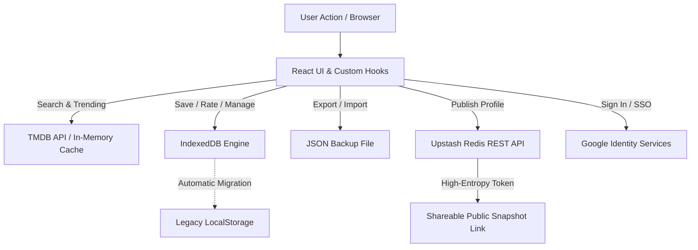

# 🎬 MovieBase

> A modern, sleek, local-first movie and TV tracking web application built with React, Vite, and Tailwind CSS. Explore trending titles, search through TMDB's vast cinematic database, curate your personalized Watchlist, Watched, and Favorites collections, and share your taste with custom unlisted links.

---

## 📑 Table of Contents
- [✨ Key Features](#-key-features)
- [🏗️ Architecture & Technical Highlights](#️-architecture--technical-highlights)
- [🛠️ Tech Stack](#️-tech-stack)
- [🔌 APIs & Backend Services](#-apis--backend-services)
- [📁 Project Structure](#-project-structure)
- [🚀 Getting Started](#-getting-started)
- [⚙️ Environment Variables](#️-environment-variables)
- [📦 Data Flow & Offline Capabilities](#-data-flow--offline-capabilities)
- [🚢 Deployment](#-deployment)

---

## ✨ Key Features

- **🔥 Explore & Discover**: Real-time trending movies and multi-search support (Movies & TV shows) powered by The Movie Database (TMDB).
- **⚡ Debounced Live Search**: Rapid, responsive search experience with request cancellation handling to eliminate race conditions and reduce redundant API calls.
- **🎥 Deep Movie Details & Trailers**: Interactive modals displaying synopses, genres, runtimes, cast, crew/directors, user ratings, and embedded YouTube trailers.
- **💾 Local-First Storage (IndexedDB)**: Instant writes and reads with zero server latency. Works 100% offline and preserves user collections directly in the browser.
- **🔄 Zero-Friction Migration**: Automatic seamless migration from legacy `localStorage` to structured `IndexedDB` on first launch.
- **🔐 Google Identity Services (OAuth 2.0)**: Lightweight client-side Google authentication using Google Identity Services (GIS) with active account switching and profile integration.
- **🌐 Cloud Snapshot Sharing**: Publish unlisted, high-entropy 128-bit cryptographic shareable links powered by serverless Upstash Redis REST API. Friends can view your public profile even when you are offline.
- **💾 Backup & Restore**: Full JSON export and import capabilities for complete data ownership and portable library migration.
- **🎨 Cinematic Aesthetic**: Dark-mode-first glassmorphic UI styled with Tailwind CSS, custom animations, accessible dialog modals, and responsive movie grids.

---

## 🏗️ Architecture & Technical Highlights

1. **Local-First Paradigm**:
   - The primary source of truth for user lists and ratings is client-side **IndexedDB** (`moviebase_db`), providing resilient persistence, offline support, and zero loading delays.
   - Decoupled from traditional server downtime or cold starts.

2. **Serverless Snapshot Sharing Pattern**:
   - Instead of exposing heavy SQL databases to public reads, shared profiles are serialized into sanitized JSON snapshots and saved to **Upstash Redis** via HTTPS REST commands.
   - Fast global edge reads, private-by-default tokenization, and instant revocability.

3. **In-Memory Caching & Stale-While-Revalidate**:
   - TMDB queries and trending requests utilize an in-memory TTL cache (5-minute window) to prevent rate-limiting and accelerate navigation.

4. **Code Splitting & Route Suspense**:
   - All major routes (`Home`, `Profile`, `SharedProfile`, `PublicProfile`, `NotFound`) are lazy-loaded via `React.lazy()` and wrapped in `Suspense` with custom skeleton loaders to ensure minimal initial bundle size.

---

## 🛠️ Tech Stack

- **Frontend Core**: [React 18](https://react.dev/) + [Vite](https://vitejs.dev/)
- **Routing**: [React Router v6](https://reactrouter.com/) (Declarative Client-side Routing)
- **Styling**: [Tailwind CSS 3](https://tailwindcss.com/) + PostCSS + Autoprefixer
- **State Management**: React Context (`AuthContext`, `ToastContext`) + Custom Hooks (`useMovies`, `useSearch`, `useAuth`, `useToast`)
- **Local Persistence**: IndexedDB (Native Web API with Promise-based transactions) + `localStorage` fallback
- **Cloud Snapshot Store**: [Upstash Redis](https://upstash.com/) (Serverless REST API)
- **Authentication**: Google Identity Services (GIS OAuth 2.0 Client Flow) & Supabase Auth (Hybrid Support)
- **Data Source**: [TMDB API (The Movie Database)](https://www.themoviedb.org/documentation/api)

---

## 🔌 APIs & Backend Services

| Service | Protocol / Client | Purpose |
| :--- | :--- | :--- |
| **The Movie Database (TMDB)** | REST API (v3) | Trending media, multi-search (movies/shows), credits, cast, and video trailer endpoints. |
| **Upstash Redis** | Serverless REST API | Low-latency key-value store for unlisted public collection snapshots (`mb_<token>`). |
| **Google Identity Services** | OAuth 2.0 Web SDK | Lightweight single sign-on (SSO) popup authentication and profile retrieval. |
| **Supabase (Optional/Hybrid)** | `@supabase/supabase-js` | PostgreSQL schema, Row Level Security (RLS), and analytics telemetry tracking. |

---

## 📁 Project Structure

```text
moviebase/
├── public/                 # Static assets
├── src/
│   ├── components/         # Reusable presentation & layout components
│   │   ├── ui/             # Atomic UI kit (Button, Modal, Badge, Toast, etc.)
│   │   ├── AuthModal.jsx   # Google OAuth authentication dialog
│   │   ├── MovieCard.jsx   # Poster card with hover interactions & quick actions
│   │   ├── MovieDetailModal.jsx # Rich movie details, cast, and trailer view
│   │   ├── MovieGrid.jsx   # Responsive grid layout with loading skeletons
│   │   ├── Navbar.jsx      # Global sticky navigation with glassmorphism
│   │   ├── ProfileHeader.jsx # User stats, identity banner, and actions
│   │   └── SearchBar.jsx   # Debounced search input with clear actions
│   ├── config/             # Environment, TMDB, and Supabase client configs
│   ├── context/            # React Contexts (AuthContext, ToastContext)
│   ├── hooks/              # Custom hooks (useMovies, useSearch, useAuth, etc.)
│   ├── lib/                # Shared enums, constants, rating scores, routes
│   ├── pages/              # Lazy-loaded page views
│   │   ├── Home.jsx        # Trending feed & search exploration
│   │   ├── Profile.jsx     # Personal library management & sharing controls
│   │   ├── SharedProfile.jsx # Public shared snapshot page
│   │   └── NotFound.jsx    # 404 handler
│   ├── services/
│   │   ├── api/            # TMDB API wrappers with in-memory caching
│   │   ├── backend/        # Redis snapshots & Supabase analytics/auth services
│   │   └── storage/        # IndexedDB engine & localStorage legacy handler
│   ├── utils/              # Data formatting and sanitization helpers
│   ├── App.jsx             # Router and global provider wrapper
│   └── main.jsx            # Application entry point
├── supabase/               # SQL schema definitions and RLS policies
├── tailwind.config.js      # Custom theme colors and layout extensions
├── vite.config.js          # Build configuration and path aliases (@/*)
└── package.json
```

---

## 🚀 Getting Started

### Prerequisites
- Node.js (v18.0.0 or higher recommended)
- npm, pnpm, or yarn

### Installation

1. **Clone the repository**:
   ```bash
   git clone https://github.com/your-username/moviebase.git
   cd moviebase
   ```

2. **Install dependencies**:
   ```bash
   npm install
   ```

3. **Configure Environment Variables**:
   Create a `.env` file in the root directory based on `.env.example`:
   ```bash
   cp .env.example .env
   ```
   Fill in your API credentials (see [Environment Variables](#️-environment-variables)).

4. **Run development server**:
   ```bash
   npm run dev
   ```
   Open [http://localhost:5173](http://localhost:5173) in your browser.

5. **Build for production**:
   ```bash
   npm run build
   ```

---

## ⚙️ Environment Variables

Create a `.env` file in the root directory with the following configuration:

```env
# TMDB API Key (Required for movie search and trending catalog)
VITE_TMDB_API_KEY=your_tmdb_api_key_here

# Upstash Redis (Required for public snapshot sharing)
VITE_UPSTASH_REDIS_REST_URL=https://your-upstash-instance.upstash.io
VITE_UPSTASH_REDIS_REST_TOKEN=your_upstash_rest_token_here

# Google OAuth 2.0 Client ID (Optional / Recommended for Google Login)
VITE_GOOGLE_CLIENT_ID=your_google_client_id.apps.googleusercontent.com

# Supabase Credentials (Optional for analytics / backend sync)
VITE_SUPABASE_URL=https://your-project.supabase.co
VITE_SUPABASE_ANON_KEY=your_supabase_anon_key
```

---

## 📦 Data Flow & Offline Capabilities



1. **Local Writes**: Adding a movie to *Watchlist*, *Watched*, or *Favorites* writes asynchronously directly to **IndexedDB**, guaranteeing zero UI lag.
2. **Sharing**: Clicking "Share Profile" packages the user's selected categories into a JSON payload and publishes it to **Upstash Redis** under a unique `mb_<random16byte>` key.
3. **Reading Shared Profiles**: Any recipient visiting `/share/:token` queries Upstash REST without needing authentication or accessing the owner's client database.

---

## 🚢 Deployment

The application is optimized for deployment on platforms like [Vercel](https://vercel.com/) or [Netlify](https://www.netlify.com/):

1. Push your repository to GitHub.
2. Import the project into Vercel.
3. Add your environment variables in the project settings.
4. Framework preset will automatically detect **Vite**. Run build command `npm run build` and output directory `dist`.
